This guide is for home service pros who use the Lead Capture Spark. Homeowners answer a few quick questions about their project, then tell you how they'd like to hear from you: a call, an appointment, or more info by email or text. You get the lead, scored and ready for your call.

## Create your Spark

The first time you open **Manage My Spark**, a short setup screen walks you through it.

1. **"What's your trade?"** Pick your trade. If you chose it when you signed up, it's already selected.

   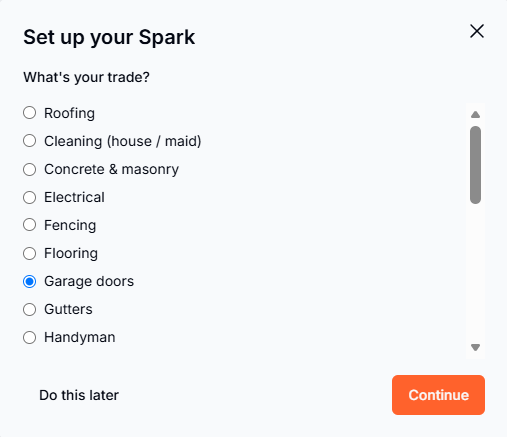

2. **"Do you have a website?"** If you do, enter it. "Just enter your website and we'll pull in your logo, colors, and contact details." No website? No problem. You'll share your Spark with a link and QR code instead.

   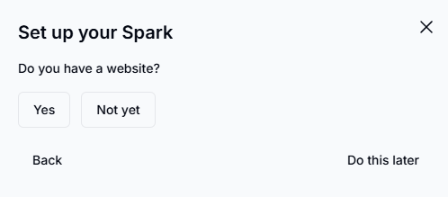

3. **Logo and colors.** Pick the logo and colors that fit your brand. You can change them later.

   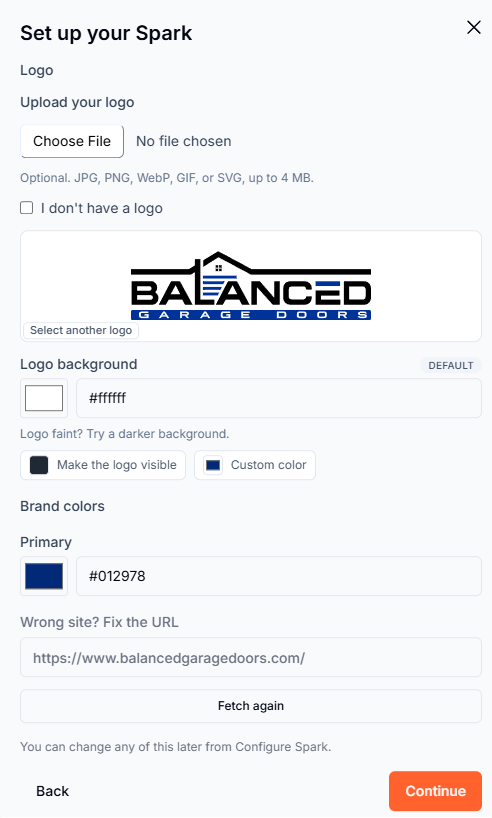

4. **Business details.** Check your business email, phone, and "Business address (optional)". These are "Shown to homeowners on your widget."

   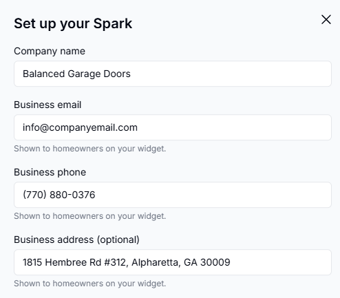

5. **"What should homeowners ask you for?"** "This sets your button and the first thing homeowners see." Choose "A free estimate", "A free inspection", "A free quote", or "A consultation".

   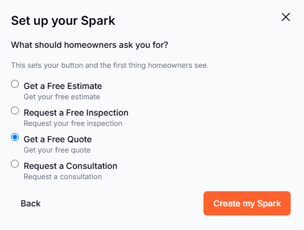

6. **Create your Spark.** When it's ready, you'll see "Your Spark is live!" Click **See it live** to open it in a new tab.

   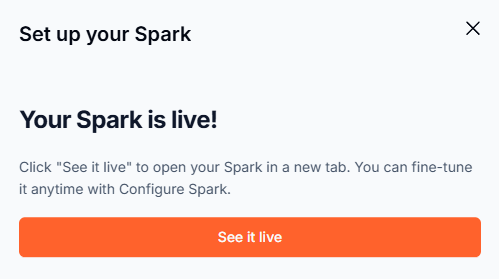

Only account owners and admins can set up a Spark.

## Customize your Spark

From **Manage My Spark**, click **Configure Spark**. Your Spark has three tabs: **Branding**, **Website Button**, and **Publish**.

### Branding

Update your logo, colors, and the details homeowners see. The **Advanced** section at the bottom of the tab has more color options, including the background for your hosted page.

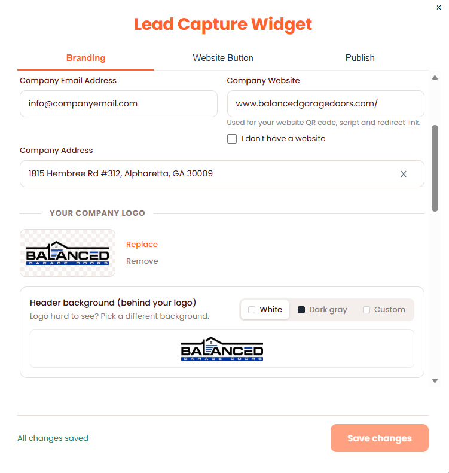

### Homeowner questions

At the bottom of the **Branding** tab, open **Advanced**. Under **Request Questions**, choose your **Industry** to load ready-made questions and answers for your trade. Expand the questions to edit any question or answer, or reset them back to the industry default.

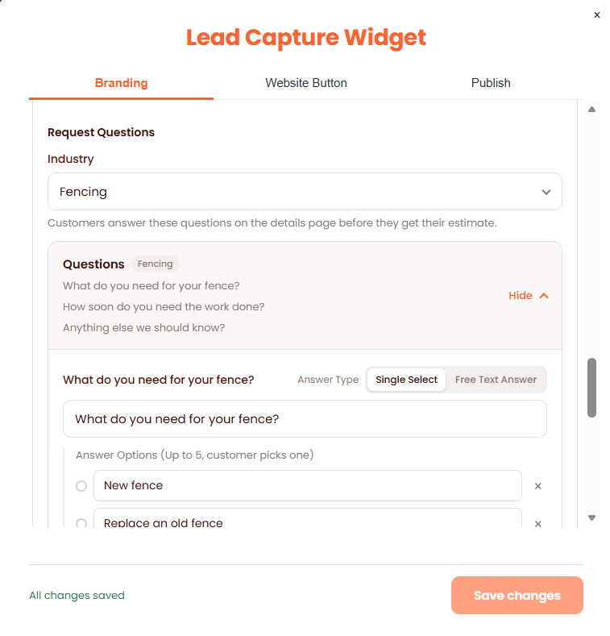

### Website Button

Choose how the button on your website looks.

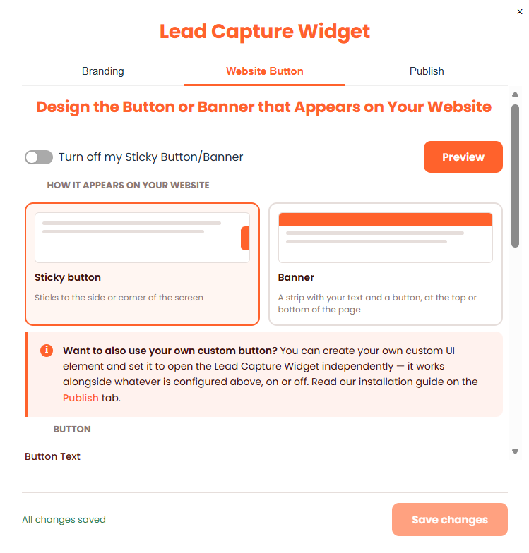

### Publish

Your script, hosted page link, and QR code live here.

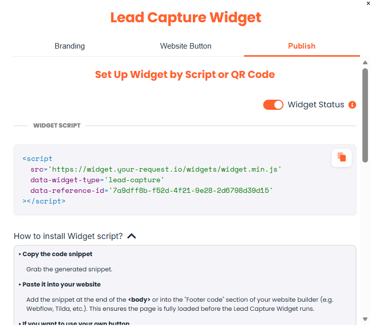

## Install on your website

Copy the script from the **Publish** tab and paste it into your site, just before the closing `</body>` tag. If you have a website, we'll also email you the install instructions when your Spark goes live. You can resend them anytime from **Manage My Spark**.

### Use your own button

To open your Spark from your own button or link, use this function:

```html
<button onclick="leadCaptureOpen()">Open</button>
```

Or add the `lead-capture-open` class to any element. You can use the same class on as many elements as you like.

## No website? Use your hosted page

Every Lead Capture Spark has its own hosted page on `app.your-request.io`. Share the link from the **Publish** tab on social media, or print the QR code on your truck, yard signs, or door hangers. Homeowners who scan it land right on your Spark.

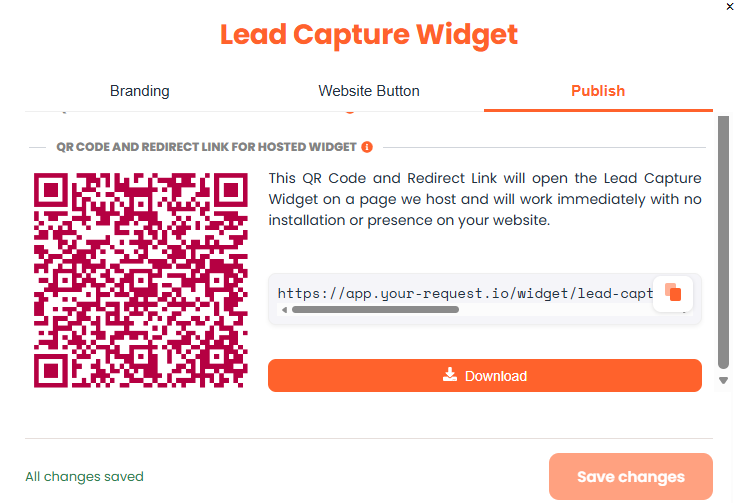

## What Happens Next

Once your SPARK is enabled, homeowners can interact with your widget and leads will begin appearing in your dashboard in real time. Each qualified lead includes contact information, project details, lead scores, and AI-generated Sales Hacks to guide your outreach.

**Ready to make the most of your leads?** [View the Lead Dashboard Guide →](/guides/lead-dashboard)

## Next steps

- [Track where your leads come from](/guides/lead-tracking)
- [Work your leads in the Lead Dashboard](/guides/lead-dashboard)
