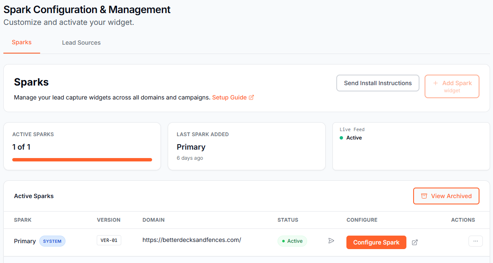

Spark360 has two kinds of Spark. Which one you have depends on the trade you picked when you signed up.

- **Roof Estimate Spark** for roofing companies. Homeowners get an instant roof estimate, and you get the lead with their estimate and project details.
- **Lead Capture Spark** for other home service trades. Homeowners answer a few quick questions about their project, and you get the lead with their answers.

Both come with the same lead scores, buyer insights, and lead dashboard, and every lead is exclusive to you.

<CardGroup cols={2}>
  <Card title="Set up a Roof Estimate Spark" href="/guides/setup-roof-estimate" />
  <Card title="Set up a Lead Capture Spark" href="/guides/setup-lead-capture" />
</CardGroup>

## Find your Sparks

<Note>
  From your dashboard, look for the **orange beacon** on the **Manage My SPARK** button in the left sidebar. That beacon is your signal that your SPARK has not yet been configured. Click it to open the Manage My Spark page and get started.
</Note>

Go to **Manage My Spark** and open the **Sparks** tab. Each Spark shows its status, a **Configure Spark** button, and a **View live Spark** icon that opens your hosted page in a new tab.

The Sparks tab provides:

- **Active Sparks card**: shows how many widgets you have configured and your tier limit (e.g., "1 of 3")
- **Last Spark Added card**: shows when you most recently added a widget
- **Live Feed card**: real-time status indicator showing whether your widgets are live and capturing leads
- **Setup Guide link**: opens this guide in a new tab
- **Active Sparks table**: lists each configured widget with its name, version, domain, status, and actions
- **Configure Spark button**: opens the configuration screen for that widget
- **View live Spark icon**: opens your hosted page in a new tab
- **Actions menu (…)**: archive a widget (non-Primary widgets only), rename, and other per-widget options
- **View Archived button**: switch between active and archived widgets

## Install the widget script

To add your Spark to your website, copy the script shown on the **Publish** tab of your Spark and paste it into your site, just before the closing `</body>` tag. Always copy the script from your own Spark, since it's unique to you.

The steps are a little different for each Spark:

- [Install a Roof Estimate Spark](/guides/setup-roof-estimate#install-on-your-website)
- [Install a Lead Capture Spark](/guides/setup-lead-capture#install-on-your-website)

## Next steps

- [Track where your leads come from](/guides/lead-tracking)
- [Work your leads in the Lead Dashboard](/guides/lead-dashboard)
- [Set your pricing](/guides/pricing-templates) (Roof Estimate Sparks only)
